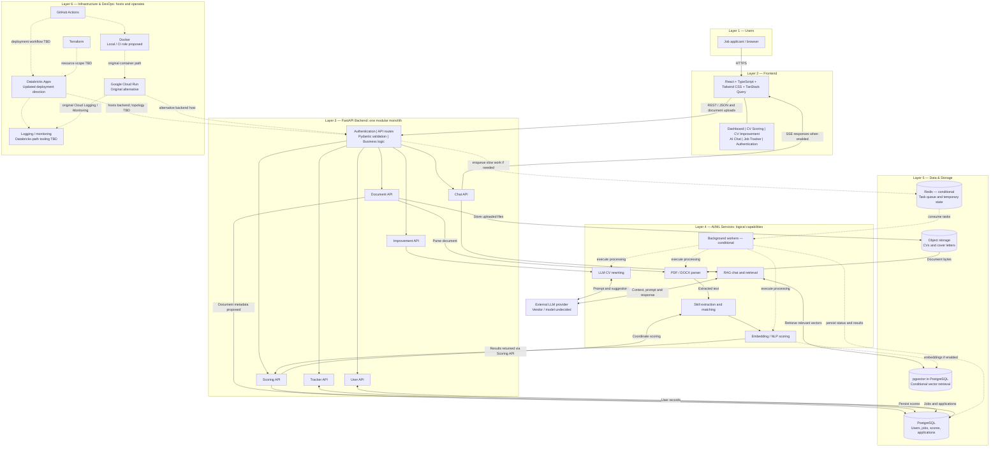

# ApplyAssist — Architecture Memory & Reference

Updated: 30 October 2026  
Purpose: Preserve the six-layer architecture for Miro, implementation planning, and future project conversations.  
Status: Architecture baseline, not a record of an implemented or deployed system.

## 1. Source and decision status

Based on the user-supplied **“1. Recommended architecture for Miro”** excerpt from [Architecture Diagram Planning](chatgpt-conversation://6ae0a451-e7f4-83ec-9161-397f50d9b4cd), plus the later request to use GitHub Actions, Databricks Apps, Terraform, and Docker.

The source describes an HTML prototype with Overview, CV & Cover Letter Scoring, CV Improvement, AI Assistant, and Application Tracker. It describes browser-side heuristic scoring, scripted chat, and localStorage. These are source-reported observations; the prototype was not independently inspected for this reference.

Status labels:

- **Confirmed:** Explicitly retained or selected in the current project request.
- **Proposed:** Recommended in the original architecture; not independently confirmed as adopted.
- **Optional / conditional:** Introduce only when the corresponding capability requires it.
- **Original alternative:** Preserved historical deployment plan, superseded as the current planning direction.

| Choice | Status | Interpretation |
| --- | --- | --- |
| Six-layer architecture | Confirmed | Preserve the logical layers below. |
| FastAPI modular monolith | Confirmed for this reference | One backend application with independently organized modules; no requirement for six deployed services. |
| Databricks Apps | Confirmed deployment direction | Updated alternative to the original Cloud Run plan; detailed deployment design remains to be validated. |
| GitHub Actions, Docker, Terraform | Confirmed tooling choices | Exact build, provisioning, and deployment responsibilities remain to be defined. |
| React, TypeScript, Tailwind CSS, TanStack Query | Proposed | Original frontend recommendation. |
| PostgreSQL | Proposed | Original system-of-record recommendation. |
| Object storage | Proposed | Store uploaded CVs and cover letters; provider remains open. |
| Redis and separate background workers | Optional / conditional | Use when asynchronous processing or temporary shared state requires them. |
| pgvector, embeddings, RAG | Proposed / conditional | Retain in the design; enable when retrieval and semantic matching are needed. |
| External LLM provider | Proposed; provider undecided | Supports rewriting and chat; no vendor or model selected. |
| Google Cloud Run | Original alternative | Retain as a deployment option, not a second mandatory runtime. |
| Cloud Logging / Monitoring | Original GCP recommendation | Observability remains required in the design; tooling for the Databricks path is undecided. |

## 2. Six-layer architecture

### Layer 1 — Users

- Job applicants access ApplyAssist through a web browser.
- Browser traffic uses HTTPS.

### Layer 2 — Frontend

**Proposed stack:** React, TypeScript, Tailwind CSS, TanStack Query.

| Component | Responsibility | Backend interaction |
| --- | --- | --- |
| Dashboard / Overview | Summarize scores, activity, and applications | Scoring and Tracker APIs; User API as needed |
| CV & Cover Letter Scoring | Upload documents, request scoring, display feedback | Document and Scoring APIs |
| CV Improvement | Request and review suggested CV changes | Document and Improvement APIs |
| AI Chat / AI Assistant | Submit messages and display answers | Chat API; SSE when streaming is enabled |
| Job Tracker / Application Tracker | Create and update application records | Tracker API |
| Authentication | Sign-in experience and user session state | Authentication functionality and User API |

Use REST with JSON for ordinary API requests and responses. Use a file-upload request for document bytes; JSON can carry document metadata and identifiers. SSE is the proposed transport for streamed responses. The identity provider and session/token mechanism are not yet selected.

### Layer 3 — FastAPI Backend

**Confirmed shape:** One FastAPI application acting as the central backend entry point.

Shared responsibilities: authentication, API routing, Pydantic validation, and business logic. User authorization and ownership checks are proposed implementation requirements across modules.

| Module | Responsibility |
| --- | --- |
| Document API | Receive uploads, manage document metadata, initiate parsing, expose document status |
| Scoring API | Coordinate skill matching and scoring; return and persist results |
| Improvement API | Coordinate CV rewriting and return improvement suggestions |
| Chat API | Coordinate conversation, retrieval where enabled, and streamed responses |
| Tracker API | Manage jobs and application records |
| User API | Manage user profile and user-related application data |

These are module boundaries, not separate deployable microservices. Detailed endpoint paths, database schemas, and internal interfaces are still to be designed.

### Layer 4 — AI/ML Services

Logical processing capabilities from the original recommendation:

- **PDF / DOCX parser:** Extract text from uploaded documents.
- **Skill extraction & matching:** Identify skills and compare them with job requirements.
- **Embedding / NLP scoring:** Support semantic comparison and scoring.
- **LLM CV rewriting:** Produce proposed CV improvements using an external LLM.
- **RAG chat & retrieval:** Retrieve relevant context for grounded chat responses.
- **Background job workers:** Execute slow processing asynchronously when required.

“Services” here describes responsibilities, not a mandate to deploy each capability separately. They can begin as internal modules called by FastAPI. Separate workers are conditional on workload and runtime needs. Parser libraries, embedding models, LLM vendor, retrieval design, and worker framework remain open.

### Layer 5 — Data & Storage

The supplied excerpt lists these components between Layers 4 and 6 without printing a Layer 5 heading. **Data & Storage** is an editorial heading restoring the intended six-layer structure.

| Component | Original intended use | Status |
| --- | --- | --- |
| PostgreSQL | Users, jobs, scores, and applications | Proposed |
| pgvector within PostgreSQL | Embeddings and vector retrieval | Proposed / conditional |
| Object storage | Uploaded CVs and cover letters | Proposed; provider undecided |
| Redis | Task queue and temporary state | Optional / conditional |

PostgreSQL holds structured application records; object storage holds document files. Redis is not the permanent system of record. Moving the app runtime to Databricks Apps does not by itself replace these components with Databricks data products.

### Layer 6 — Infrastructure & DevOps

**Current direction:** GitHub Actions, Docker, Terraform, and Databricks Apps.

- **GitHub Actions:** Intended CI/CD orchestration for checks and deployment workflows.
- **Docker:** Selected tooling; proposed for reproducible local development and CI environments. Its role in the final deployment artifact must be validated.
- **Terraform:** Intended infrastructure-as-code tooling; supported resources and ownership boundaries must be defined.
- **Databricks Apps:** Updated application deployment target. Frontend serving, FastAPI startup, identity integration, data connectivity, and any separate worker runtime require a deployment design.
- **Logging / monitoring:** Retain application logs, errors, request/job status, and operational monitoring as design concerns; select tools for the chosen environment.

**Original alternative:** GitHub Actions → Docker-based build → Google Cloud Run, with Terraform and Cloud Logging / Monitoring.

The Databricks path is an architectural update, not evidence that an arbitrary Docker image can be deployed directly to Databricks Apps. Deployment packaging and supported mechanisms must be checked during implementation. Do not assume separate workers run inside the app runtime.

Infrastructure hosts and operates the system. It is not another step through which user requests pass.

## 3. Mermaid architecture diagram

Solid arrows show the proposed application interactions. Dotted arrows show optional processing or infrastructure relationships. Except for the confirmed decisions in Section 1, nodes represent the original recommended design rather than implemented components.

The diagram groups logical interactions; it does not specify every read, return response, network boundary, or physical deployment. In particular, placement of the frontend and workers remains open.

## 4. Core data flows

1. **Sign-in and application access:** Browser loads the frontend over HTTPS. The frontend uses the selected authentication flow, then calls FastAPI. FastAPI validates requests and checks access before handling user data. Identity provider details remain open.
2. **Upload and parsing:** Frontend → Document API → object storage for the original file. Document API invokes the parser directly or, conditionally, queues work through Redis for a worker. Document metadata and processing status in PostgreSQL are proposed implementation details.
3. **Scoring:** Frontend → Scoring API → skill extraction/matching → embedding/NLP scoring, using the document text and relevant job requirements. The Scoring API persists results in PostgreSQL and returns scores and feedback to the frontend.
4. **CV improvement:** Frontend → Improvement API → rewriting capability → external LLM → suggested changes → frontend through FastAPI. Persistence of rewritten versions is undecided. Source text and relevant job context must be supplied to the processing module.
5. **AI chat:** Frontend → Chat API → retrieval capability, if enabled → pgvector for relevant context → external LLM → Chat API → frontend. SSE can stream the response. Chat-history storage is not yet selected.
6. **Application tracking:** Frontend → Tracker API → PostgreSQL → updated application records and dashboard summaries.
7. **Optional asynchronous work:** FastAPI → Redis task queue → separate worker → processing modules → persisted result/status. The frontend obtains completion through FastAPI; polling or a notification mechanism remains to be selected.
8. **Delivery:** Code changes → GitHub Actions checks → chosen packaging and deployment workflow → Databricks Apps. Docker and Terraform participate according to their defined roles. The original Cloud Run route remains a separately selectable alternative.

## 5. Concise architecture decision notes

### ADR-001 — Central FastAPI modular monolith

**Status:** Confirmed for this architecture baseline.  
**Decision:** One FastAPI application contains Document, Scoring, Improvement, Chat, Tracker, and User modules.  
**Rationale:** Preserve clear responsibilities without overengineering the MVP with six independently deployed services.  
**Consequence:** Keep module interfaces clear; introduce separate workers only when necessary.

### ADR-002 — Separate UI, business logic, and AI processing responsibilities

**Status:** Six-layer separation confirmed; specific frontend and AI tools proposed.  
**Decision:** Frontend presents the experience; FastAPI coordinates validated requests and business logic; AI/ML modules perform parsing, scoring, rewriting, and retrieval.  
**Consequence:** Logical separation does not require independent deployments. The prototype’s localStorage and scripted responses are not the intended production backend.

### ADR-003 — Databricks Apps updates the original hosting plan

**Status:** Confirmed deployment direction.  
**Decision:** Plan for Databricks Apps while preserving Google Cloud Run as the original alternative.  
**Consequence:** Validate deployment packaging, identity, serving topology, database/storage access, and worker hosting before implementation. Do not automatically replace PostgreSQL, object storage, or Redis because the app host changes.

### ADR-004 — Keep delivery tooling distinct from runtime assumptions

**Status:** GitHub Actions, Docker, Terraform confirmed; detailed workflow proposed.  
**Decision:** Use these tools in the delivery design, with explicit responsibilities.  
**Consequence:** Docker usage does not establish a direct image-to-Databricks-Apps deployment path; Terraform resource coverage must be validated separately.

### ADR-005 — Use fit-for-purpose persistence

**Status:** Proposed.  
**Decision:** PostgreSQL for structured records, object storage for files, pgvector for optional semantic retrieval, Redis for conditional queue/temporary state.  
**Consequence:** Choose providers, schemas, retention rules, and backup arrangements during detailed design.

### ADR-006 — Introduce advanced processing when justified

**Status:** Optional / conditional.  
**Decision:** Enable RAG, vector search, Redis-backed jobs, and separately deployed workers as requirements justify them.  
**Consequence:** The full diagram shows the intended capabilities, not an obligation to build every component for the first MVP.

## 6. Miro drawing instructions

1. Create six horizontal frames, top to bottom, using the exact layer titles above.
2. Place the applicant/browser in Layer 1 and the frontend stack plus six feature boxes in Layer 2.
3. Draw one large FastAPI boundary in Layer 3. Place the six API modules inside it, with authentication, validation, routing, and business logic shown as shared responsibilities.
4. Place the AI/ML capabilities in Layer 4. Mark background workers as conditional; do not depict every capability as a microservice.
5. Draw PostgreSQL, object storage, and Redis as distinct Layer 5 components. Show pgvector within the PostgreSQL boundary.
6. Put the external LLM provider outside the six-layer application boundary and connect it to rewriting and chat/retrieval.
7. Use labeled solid arrows for requests/data and dashed arrows for optional or hosting relationships. Label REST/JSON, file upload, SSE, retrieval, and task queue connections.
8. In Layer 6, emphasize Databricks Apps as the updated direction and show Cloud Run in a muted box marked “Original alternative.” Do not put infrastructure in the user request chain.
9. Add a legend for Confirmed, Proposed, Optional, and Original alternative. Use text labels as well as colors.

## 7. Open decisions and memory guardrails

- Confirm adoption of the proposed frontend stack and PostgreSQL.
- Select authentication provider and session model, including how app access relates to end-user identity.
- Define frontend serving and FastAPI deployment topology on Databricks Apps.
- Validate supported deployment packaging and Docker’s exact role.
- Define Terraform-managed resources and CI/CD environments.
- Select object storage provider, parser libraries, LLM/embedding models, and retrieval approach.
- Decide whether MVP latency and workload require Redis and separate workers; choose their runtime if needed.
- Specify scoring quality criteria, evaluation datasets, and acceptance thresholds; these are not established by the supplied excerpt.
- Define chat-history and generated-document persistence, data retention, and observability tooling.

For future project work: preserve the six logical layers and FastAPI modular-monolith decision. Treat Databricks Apps as the updated deployment direction and Cloud Run as the original alternative. Do not promote proposed components to confirmed decisions, infer implementation completion, or invent provider/model choices from this reference.
